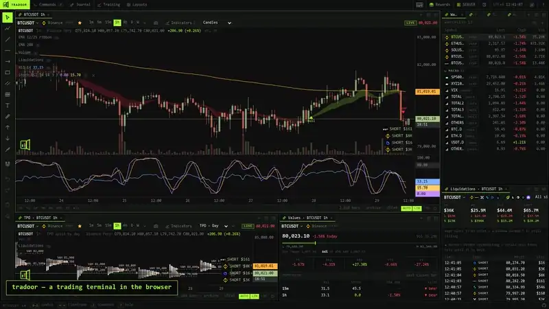
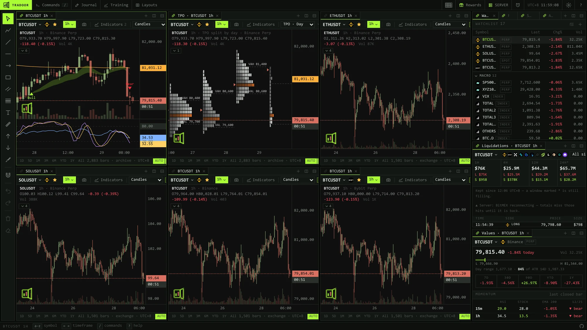
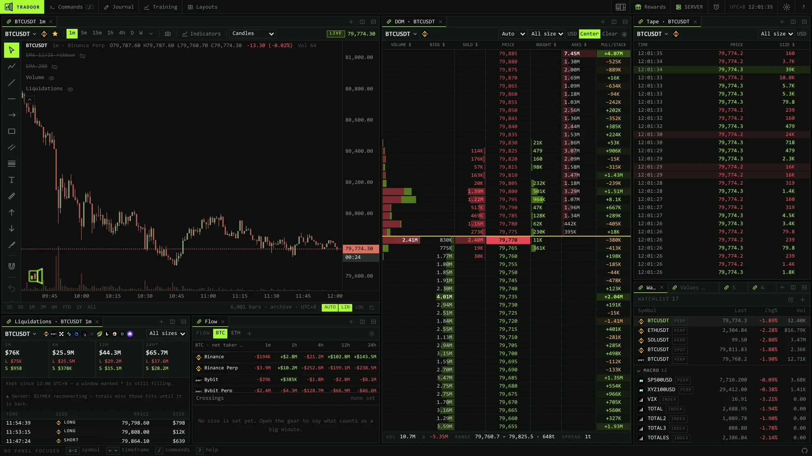
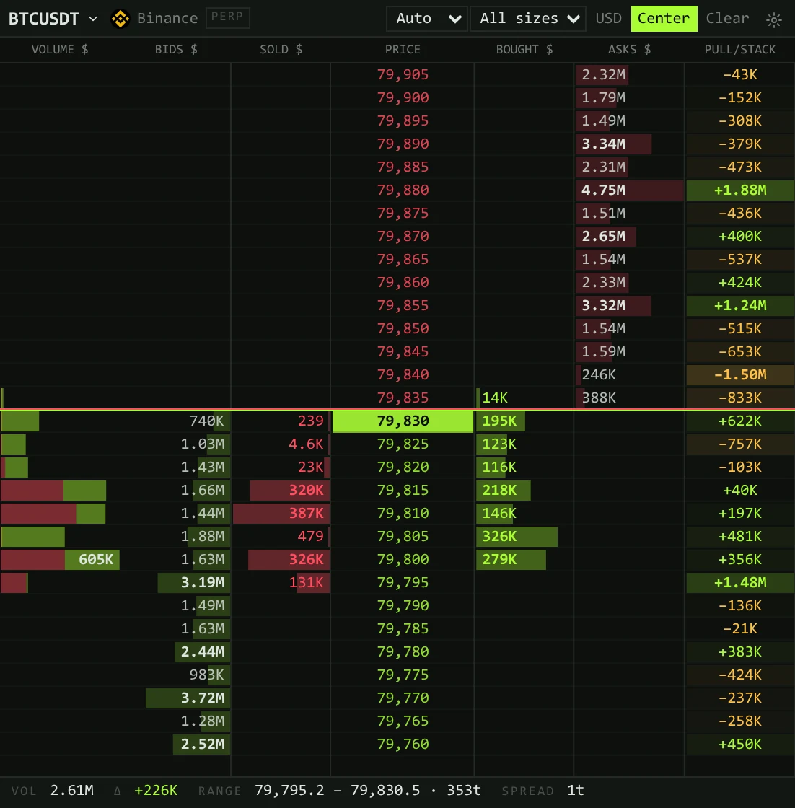
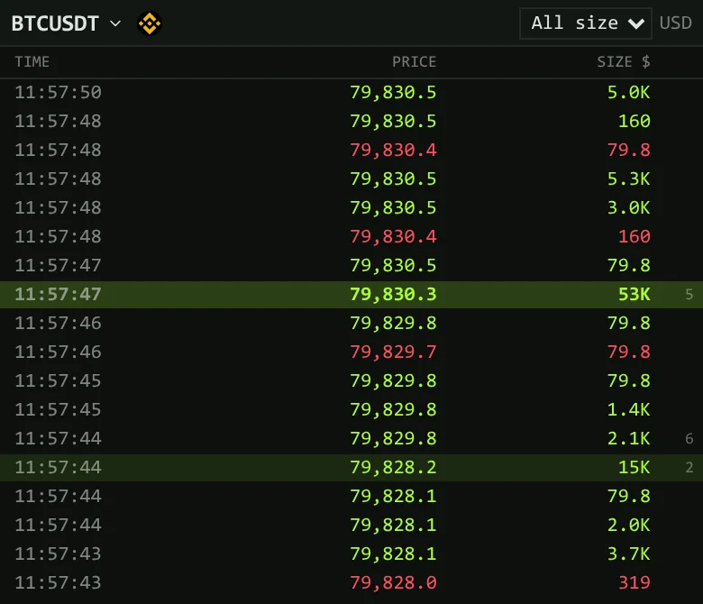
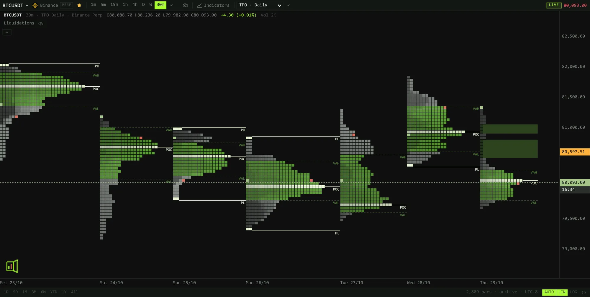
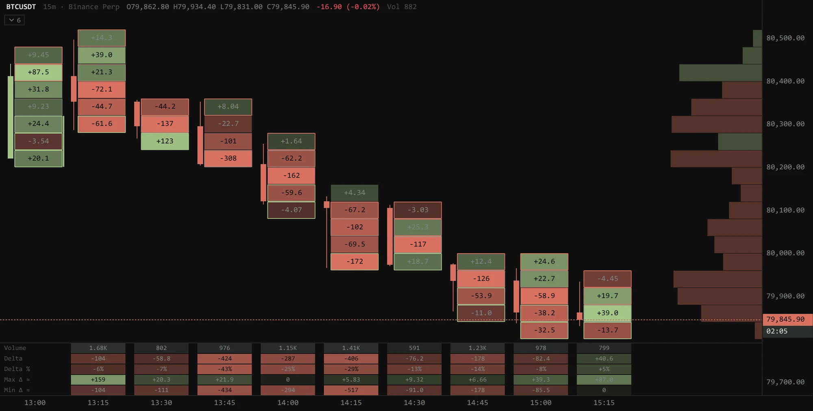

<p align="center">
  <a href="https://tradoor.rsalianto.com/">
    
  </a>
</p>

<h1 align="center">tradoor</h1>

<p align="center">
  <b>A trading terminal in the browser, built for speed.</b><br>
  TradingView-style charts, ExoCharts-style market profiles and a DOM in a workspace you lay out yourself, drawn by a Rust engine in WebAssembly and fed live from the exchanges.
</p>

<p align="center">
  
  
  
  
  
  <a href="https://github.com/rsalianto/tradoor/releases/latest"></a>
  <br>
  
</p>

<p align="center">
  <a href="https://tradoor.rsalianto.com/"></a>
</p>

<p align="center">
  <a href="#features">Features</a> ·
  <a href="#everything-in-the-box">Everything in the box</a> ·
  <a href="#under-the-hood">Under the hood</a> ·
  <a href="#get-started">Get started</a> ·
  <a href="#self-hosting">Self-hosting</a> ·
  <a href="#security">Security</a> ·
  <a href="docs/architecture.md">Architecture</a> ·
  <a href="https://github.com/rsalianto/tradoor/discussions">Discussions</a>
</p>

<br>

<p align="center">
  <picture>
    <source type="image/avif" srcset="https://raw.githubusercontent.com/rsalianto/tradoor/main/docs/screenshots/demo.avif">
    
  </picture>
  <br>
  <sub>A tour of the live site: pan and zoom, TPO profiles, a footprint, six charts at once, and the DOM and tape.</sub>
</p>

**⚡ Light and fast.** The chart engine is Rust in a Web Worker, drawing with WebGL2 on an OffscreenCanvas, so the page thread never touches a candle. A minute chart with months behind it costs what one opened today does.

**📊 Order flow and market profile.** A DOM and a tape on seven exchanges, TPO profiles by session, footprints with bid and ask at every price, value areas, and a Values panel that reads a market at a glance.

**🔥 Live from the source.** Exchange streams straight to the browser: trades fold into the forming bar, order books fill the DOM, liquidations land from twelve exchanges, and net taker flow is counted per venue.

**📓 Journal and training.** Every position you draw becomes a trade that price settles, and a paper account trades Binance's perpetuals at their live prices, from the chart or the DOM.

## Features

Every screenshot is the live site, or for the journal and training a local one with sample trades.

### Many charts, one workspace

<p align="center">
  
  <br>
  <sub>Six charts from the grid menu, the new ones on the next tickers in the watchlist.</sub>
</p>

Up to 20 charts on screen, all drawing: the first four with WebGL, the rest in 2D. Pick a grid from the menu in the top bar, keep Symbol, Interval, Crosshair or Time in step across the charts, and draw on any of them from one toolbar. Every panel splits, tabs and docks by drag: drop a tab on a tab strip to reorder it, or on a panel's edge to set it beside. Four layouts are ready to start from (Classic, Multi-timeframe, Order flow, and DOM & Tape), your own are saved by name when signed in, and your watchlists stay whichever you open.

### DOM and Tape

<p align="center">
  
  <br>
  <sub>The DOM &amp; Tape layout: a one-minute chart, the DOM and the tape, all on BTCUSDT.</sub>
</p>

<p align="center">
  
  
</p>

The DOM is the order book by price on Binance, Bybit, OKX, Bitget, Kraken, Hyperliquid and Lighter: the bids and asks, the market sells and buys that traded at each price, a volume profile, and what was pulled from a level or stacked onto it beyond what trades took. A row is a tick or many, sizes are in coins or dollars, and the size filter judges whole orders, not single fills. Clear the profile, the trades or Pull/Stack, all of it or only above or below a row, or let each start again on the clock. The tape prints every trade as it lands, lights the big ones, and holds still under the pointer. Both read the exchange's own socket from the browser. In the workspace they only read; in Training the DOM trades on paper.

### Market profile

<p align="center">
  
  <br>
  <sub>A profile a day of 30-minute brackets, square blocks side by side.</sub>
</p>

Any chart can be read as TPO profiles laid out as MMT lays them out — square blocks side by side, by day, week or month, Asia, London or New York, or sessions of your own — each with its value area, point of control, single prints, poor highs and lows and, beside it, its volume, in your theme's colours. Expand, merge or split a profile from its menu; drawings and indicators stay in place.

### Footprint

<p align="center">
  
  <br>
  <sub>Fifteen-minute bars as footprints: the delta at every price, and what each bar came to underneath.</sub>
</p>

Volume bought and sold at each price inside every bar, beside a thin candle — as the delta, the two sides apart, their sum, a cluster or a ladder. The rows follow the zoom, so every cell keeps a number you can read, and a table under the bars gives each one's volume, delta, delta %, and the most and least its delta reached. The value area, imbalances and the profile of everything on screen come with it. Hourly and daily charts read the footprint's history, kept for good: Binance's BTC perpetual from January 2026, read from Binance's archive of every trade, and every recorded market from the day the server began recording it.

Every other coin gets a footprint too, recorded in your own browser while a chart shows it and kept there, never on the server: seven days by default, with recent gaps filled from Binance's trade history. Settings shows how much it takes, per coin, and deletes any of it.

### Liquidations

<p align="center">
  
  <br>
  <sub>BTCUSDT's liquidations on every exchange, as totals and as a tape.</sub>
</p>

One ticker's liquidations from twelve exchanges as they land: a tape with each one's venue, side, price and size, totals over the last hour to day, and a feed riding up the chart above the volume.

### Signals

<p align="center">
  
  <br>
  <sub>The screener's three drives across 200 coins.</sub>
</p>

A screener scans 200 coins on the 4H, 1D and 1W for three drives into a line, with each one's entry, targets and stop, follows it until it is filled, stopped or gone, and can tell Telegram.

### Flow

<p align="center">
  
  <br>
  <sub>BTC's net taker flow per exchange, and the big minutes.</sub>
</p>

Net taker flow on each exchange, spot and perpetual, over the last minute to day, and the minutes that ran hard one way marked on the chart where they traded.

### Trading journal

<p align="center">
  
  <br>
  <sub>The journal's dashboard, with sample trades.</sub>
</p>

Every Long or Short position drawn on a chart is a trade, kept in step as you move it and settled by price — entry, then target or stop — with partial exits, averaged entries, strategies and notes. The dashboard reads it back: the figures that matter, the equity curve, a P&L calendar with each week's R, and a weekly review.

### Training

<p align="center">
  
  <br>
  <sub>Paper trading at live prices, an open long with its take profit and stop loss.</sub>
</p>

100,000 USDT on Binance's BTC, ETH and SOL perpetuals at their live prices: market and limit orders, up to 100× on isolated margin, take profit, stop loss and Reverse, with liquidation, fees and funding as Binance has them — filled by the server, browser open or not. Open the DOM beside the chart to trade from the book: click a bid to buy, an ask to sell, drag an order to move it, and Shift- or Ctrl-click a row for the stop loss or take profit.

### Everywhere

<p align="center">
  
  <br>
  <sub>On a phone: one chart and a menu.</sub>
</p>

The same terminal on a phone, with touch gestures, and on any browser that runs WebGL2 — falling back to a 2D canvas where it does not.

## Everything in the box

#### Charts

- One minute to a year; 2D, 3D, 2W, 3M, 6M and 12M folded from days with a live forming bar
- An open world for 15 minutes and shorter: a window of the newest bars, widened as you pan back
- EMA 12/25 ribbon, EMA 200, RSI, Stoch RSI, volume, key levels, anchored VWAP, open interest
- Linear or log price axis, auto scale, panes you size yourself
- A 4K picture of any chart to the clipboard

#### Drawing

- Trendline, ray, horizontal, path, brush, zone, parallel channel, fib, note, measure
- Long and short positions with risk, reward and legs
- A weak or strong magnet to the candles
- Drawings belong to the market and show on every timeframe, standing on the bar that holds them
- Undo and redo, lock, hide per timeframe

#### Order flow

- A DOM on seven exchanges: bids, asks, sold, bought, a volume profile and Pull/Stack at every price
- Rows of a tick or many, coins or dollars, a size filter that judges whole orders
- Clear all of it or one part, above or below a row, or on the clock
- A tape of every trade, the big ones lit
- Footprints, TPO profiles, and net taker flow per exchange

#### Workspace

- Splits, tabs and docking by drag
- Up to 20 charts from a grid menu, with symbol, interval, crosshair and time kept in step
- Recommended layouts, your own saved by name, and export or import as a file
- Colour link groups: one symbol, many panels
- Command palette, symbol search across every venue, keyboard first
- Watchlists, price alerts to Telegram, themes, light ones included
- Signed in with Telegram, the same workspace on every device

#### Markets

- Spot and perpetuals on Binance, Bybit, OKX, Bitget, Kraken; perpetuals on Hyperliquid and Lighter
- TOTAL, TOTAL2, TOTAL3, TOTALES, OTHERS, BTC.D, ETH.D, USDT.D, OTHERS.D and the VIX
- The S&amp;P 500 and Nasdaq-100 as trade.xyz's perpetuals
- One market priced in another, as a ratio

#### History

- Columnar partitions of about 16 bytes a minute: five years of BTCUSDT minutes in 42 MB
- Served from disk or a CDN, cached by the browser for a year
- Markets not archived chart straight from the exchange's REST API

#### Server

- Rust — Axum and Tokio — with PostgreSQL 18 for metadata only
- A day of liquidations, open interest and flow for the tickers it follows
- Rate limits per address and per exchange host
- One Docker image, deployed from CI

## Under the hood

- **Chart engine**: Rust compiled to WebAssembly (about 155 KB gzip after wasm-opt), run in a Web Worker. Candles are drawn with WebGL2 on an OffscreenCanvas, text on a 2D layer and the liquidation feed on a third, so the page thread never touches a candle.
- **History**: Immutable columnar partition files, about 16 bytes per 1-minute bar: five years of BTCUSDT perpetual minutes is 42 MB. Served from disk or a CDN and cached by the browser for a year.
- **Live**: Exchange WebSockets straight to the browser: trades folded into the forming bar between kline updates, order books kept for the DOM, and liquidations feeding a ticker above the volume and a tape of their own as they land. The server relays a stream only when the browser cannot reach the exchange.
- **Server**: Rust — Axum and Tokio — for the market catalogue, drawings and workspaces, accounts, the journal and training, and a day of liquidations for a few tickers.
- **Database**: PostgreSQL 18, for metadata only. Candles never enter it.
- **UI**: SolidJS (about 52 KB brotli): splits, tabs, docking by drag, link groups, command palette, theme; one chart and a menu on a phone.

```text
crates/core      candles, timeframes, indicators and studies with Pine Script semantics; no dependencies
crates/codec     the TDC1 partition format (docs/format.md)
crates/venues    the exchanges: market lists, klines, Binance's archives
crates/store     the data directory and PostgreSQL metadata
crates/ingest    archive and REST sync into partitions
crates/render    the chart as a pure model: layout, scales, interaction, frames
crates/wasm      the browser engine: WebGL2 and text, decoding, folding, live bars
bins/server      tradoor-server — API, /data, and optionally the built web app
bins/backfill    tradoor-backfill — download history
bins/recorder    tradoor-recorder — keep tracked markets current
web/             the SolidJS app, built with Vite under Deno
migrations/      PostgreSQL schema, applied by every binary on start
deploy/          systemd units and an nginx site
```

How the pieces fit is in [docs/architecture.md](docs/architecture.md), and the partition format in [docs/format.md](docs/format.md).

## Get started

**Requirements**

- Rust 1.95 with the `wasm32-unknown-unknown` target, and `wasm-bindgen-cli` 0.2.128
- Deno 2
- Docker, for PostgreSQL
- Optional: `wasm-opt` from binaryen, which `scripts/build-wasm.sh` uses when present

**Run it locally**

```sh
cp .env.example .env          # choose a database password
docker compose up -d          # PostgreSQL 18 in its own container, on 127.0.0.1:5438
./scripts/build-wasm.sh       # the chart engine, into web/src/wasm/pkg
cargo build --release

set -a; . ./.env; set +a
# Five years of BTCUSDT perpetual, tracked so the recorder keeps it current.
./target/release/tradoor-backfill binance-perp:BTCUSDT --from 2021-09-01 --track
./target/release/tradoor-recorder &
./target/release/tradoor-server

cd web && deno install && deno task dev   # http://127.0.0.1:5173
```

Markets are written `venue:SYMBOL`: `binance-spot`, `binance-perp`, `bybit-spot`,
`bybit-perp`, `okx-spot`, `okx-perp`, `bitget-spot`, `bitget-perp`,
`hyperliquid-perp`, `kraken-spot`, `kraken-perp`, `lighter-perp`, or `index` for
the market measures the server works out itself. A market that has not been
backfilled still charts: its candles come from the exchange's REST API instead
of partitions.

**Tests**

`cargo test` runs the Rust tests; `deno task check` type-checks the web app,
`deno task test` replays recorded exchange payloads through the stream hub, and
`deno task size` checks the bundle budget after `deno task build`.

**Keyboard**

`a–z` search a symbol · `← →` timeframe · `/` or `Ctrl K` commands · `?` help ·
`Esc` cancel a tool or deselect · `Delete` remove the selected drawing · drag a
tab onto another group, or its edge, to dock it.

## Self-hosting

<details>
<summary><b>Production on a server</b></summary>

<br>

The `Dockerfile` builds one image holding the three binaries and the web app.
`deploy/compose.yml` runs it beside PostgreSQL and copies the web app out to
`./web`; the host's nginx serves that folder and proxies `/api` and `/data`
(`deploy/nginx/tradoor.conf`). For a Debian server with Docker and nginx, in
`/var/www/tradoor`:

```sh
# On your machine: build the image and copy it and the deploy files over.
docker build -t tradoor:latest .
ssh user@server 'sudo mkdir -p /var/www/tradoor && sudo chown $USER /var/www/tradoor'
docker save tradoor:latest | gzip | ssh user@server 'gunzip | docker load'
scp deploy/compose.yml deploy/nginx/tradoor.conf deploy/nginx/security-headers.conf deploy/nginx/http.conf user@server:/var/www/tradoor/
scp deploy/env.example user@server:/var/www/tradoor/.env

# On the server.
cd /var/www/tradoor
nano .env        # POSTGRES_PASSWORD: openssl rand -hex 24
docker compose up -d
docker compose run --rm server tradoor-backfill binance-perp:BTCUSDT --from 2021-09-01 --track

sudo cp tradoor.conf /etc/nginx/sites-available/tradoor   # set server_name first
sudo cp security-headers.conf /etc/nginx/snippets/tradoor-security-headers.conf
sudo cp http.conf /etc/nginx/conf.d/tradoor.conf
sudo ln -s /etc/nginx/sites-available/tradoor /etc/nginx/sites-enabled/
sudo nginx -t && sudo systemctl reload nginx
sudo certbot --nginx -d tradoor.example.com
```

The server and recorder apply database migrations when they start; partitions
live in the `data` volume. Drawings and layouts need no setup: each browser
keeps its own under its browser id.

To update, rebuild and load the image again, then `docker compose up -d` on the
server; that also refreshes `web/`. Without Docker, `deploy/systemd` runs the
binaries directly.

</details>

<details>
<summary><b>CI and deploy</b></summary>

<br>

`.github/workflows/ci.yml` runs on every push and pull request: Rust tests, the
WASM engine, and the web app's type check, build and size budget. A push to
`main` then builds the image with its dependency layers cached, pushes it to
GitHub Container Registry as `ghcr.io/<owner>/tradoor:<commit>`, copies
`deploy/compose.yml` to the server, points `TRADOOR_IMAGE` in `.env` at that
commit, runs `docker compose up -d` and waits for `/api/health`. Pull requests
from forks run the tests only, without the repository's secrets.

One-time setup, after the server runs the stack as described above:

```sh
# A key only GitHub Actions uses, authorised on the server.
ssh-keygen -t ed25519 -N '' -C tradoor-github-actions -f ~/.ssh/tradoor_deploy
ssh -p <port> root@<server> 'cat >> ~/.ssh/authorized_keys' < ~/.ssh/tradoor_deploy.pub

# Repository secrets.
gh secret set VPS_HOST --body <server>
gh secret set VPS_PORT --body <port>
gh secret set VPS_USER --body root
gh secret set VPS_SSH_KEY < ~/.ssh/tradoor_deploy
ssh-keyscan -p <port> <server> | gh secret set VPS_KNOWN_HOSTS
```

To roll back, set `TRADOOR_IMAGE` in `/var/www/tradoor/.env` to an earlier
commit's tag and run `docker compose up -d`.

</details>

<details>
<summary><b>Search engines and link previews</b></summary>

<br>

Set the repository variable `SITE_URL` to the site's address (`gh variable set
SITE_URL --body https://your-domain`). The image build passes it to the web
build, which then writes the canonical URL, absolute Open Graph image, and
`robots.txt` with a `sitemap.xml` (`web/site.ts`). The deploy also writes it to
the server's `.env` as `TRADOOR_SITE_URL`, from which the screener's Telegram
messages link each pattern to its chart. Without it the page still has
its title, description, preview tags and structured data, but no canonical URL,
sitemap or links in the messages.

</details>

<details>
<summary><b>Analytics</b></summary>

<br>

Set the repository variable `CF_BEACON` to a Cloudflare Web Analytics token
(`gh variable set CF_BEACON --body <token>`) and the next build adds Cloudflare's
beacon, counting page views, with the Content Security Policy widened to its
host (`web/site.ts`; `deploy/nginx/security-headers.conf` sends the same). It
sets no cookie, and the browser id tradoor keeps drawings and layouts under is
not given to it. Without `CF_BEACON` the page loads no analytics at all.

</details>

<details>
<summary><b>Partner exchanges</b></summary>

<br>

Rewards in the top bar (Partner exchanges in a phone's menu) lists the Nado,
Bybit and Binance referral links (`web/src/components/Referrals.tsx`). A card offers
them once per browser, a minute into its first visit, and not again once
closed or used. Open the site once with `?noreferral` on a device and the card
is never offered there.

</details>

<details>
<summary><b>Flow of other coins</b></summary>

<br>

The Flow panel always shows BTC and ETH. Signed in with Telegram, each reader
adds up to seven coins of their own from the panel's `+` (each for 24 hours,
7 days, or until stopped; Keep renews it), and only they see them. The server
records a coin once however many readers follow it, at most twenty coins at a
time, and stops recording one whose followers have all been away for two weeks.

</details>

<details>
<summary><b>Indices, the S&amp;P 500 and the Nasdaq</b></summary>

<br>

Search TOTAL, TOTAL2, TOTAL3, TOTALES, OTHERS, BTC.D, ETH.D, USDT.D,
OTHERS.D or VIX (TradingView's `CRYPTOCAP:TOTAL2` works too): the server works
these out itself under the Index venue, and a new browser's watchlist lists
them under Macro. The market caps are CoinGecko's free figures, in billions of
dollars, a minute at a time from when the server first ran. The VIX is
Cboe's, delayed: daily since 1990, and by the minute from when the server first
ran. The S&P 500 and the Nasdaq-100 are trade.xyz's perpetuals on
Hyperliquid, `SP500USD` and `XYZ100USD` (or search SPX, NASDAQ), live like any
other market.

</details>

<details>
<summary><b>Drawings and layouts belong to a browser</b></summary>

<br>

Each browser makes a random id on first visit (Settings → Advanced) and its
drawings, layout, watchlists, indicators and alerts are kept on the server
under it: a private window or another browser starts empty. Sign in with
Telegram (Settings → Account) and they follow you: on another device, or after
clearing the browser's history, sign in again and the browser has them back.
The tradoor bot asks you to confirm each sign-in in your Telegram chat.
Without a bot the id can still be carried by hand, pasted under Advanced.

Drawings and the layout saved before browsers had ids belong to nobody. Give
them to your browser's id once:

```sh
docker compose exec server tradoor-server adopt <your-browser-id>
```

To move drawings from rsalianto:

```sh
RSALIANTO_DATABASE_URL=postgres://… scripts/export-rsalianto-drawings.sh > drawings.jsonl
./target/release/tradoor-server import-drawings drawings.jsonl --owner <your-browser-id>
```

</details>

<details>
<summary><b>Weighing the signals</b></summary>

<br>

```sh
ssh user@server 'bash -s' < scripts/export-signals.sh > signals.tar.gz   # the live record, as CSV
./target/release/tradoor-server signal-research signals.jsonl           # the rules over ~500 days of bars
```

</details>

## Security

A browser that has not signed in is known by the random id it made, and that
id is what makes its drawings and layout its own; it never leaves the browser
except to this server. A browser signed in with Telegram holds a session
instead — a random token of its own, of which the server keeps only a hash —
so an account's id seen over a shoulder or in a screenshot opens nothing, and
signing out of one browser, or of all of them (`/signout` to the bot), ends
their sessions (`bins/server/src/session.rs`). The journal and training are
for accounts only.

What keeps one visitor from spoiling the server for the rest is in
`bins/server/src/limits.rs` — a request rate per address, per kind of request;
a cap on relayed and live streams per address; a shared rate per exchange host
for the relay, below what would get the server's address banned, and a cap on
how fast and how much a browser may send up a relayed stream; caps on drawings
and workspaces per browser id and on new ids per address. Open interest records
only coins some exchange lists a perpetual on.

The server reads the visitor's address from nginx's `X-Real-IP`, so it must only
be reachable through nginx — `deploy/compose.yml` publishes it on loopback.
`deploy/nginx/tradoor.conf` adds a second request limit and the security
headers, including the Content Security Policy the page also carries:

```sh
sudo cp http.conf /etc/nginx/conf.d/tradoor.conf
sudo cp security-headers.conf /etc/nginx/snippets/tradoor-security-headers.conf
sudo nginx -t && sudo systemctl reload nginx
```

`http.conf` keys nginx's limits on Cloudflare's `CF-Connecting-IP`, which the
site passes to the server; without it every visitor would share a handful of
Cloudflare addresses. It is trustworthy only where nginx admits nothing but
Cloudflare (`allow` its ranges, `deny all`) — it is deliberately not nginx's
`real_ip` module, which would make such a rule refuse every visitor. Once certbot has added
its HTTPS block, merge `tradoor.conf`'s locations into the site by hand rather
than copying it over.

## License

tradoor is free software: you can redistribute it and modify it under the terms
of the [GNU Affero General Public License, version 3](LICENSE). If you run a
modified version for others over a network, you must offer them its source.

Copyright © 2026 rsalianto.
