<p align="center">
  <a href="https://tradoorterminal.com/">
    
  </a>
</p>

<h1 align="center">tradoor terminal</h1>

<p align="center">
  <b>A fast trading terminal in the browser.</b><br>
  Charts, market profile, footprints, a DOM and your own indicators, drawn by a Rust engine in WebAssembly, live from fourteen exchanges.
</p>

<p align="center">
  
  
  
  
  
  <a href="https://github.com/rsalianto/tradoor/releases/latest"></a>
</p>

<p align="center">
  <a href="https://tradoorterminal.com/"></a>
</p>

<p align="center">
  <a href="#features">Features</a> ·
  <a href="#frost-script">Frost Script</a> ·
  <a href="#run-it">Run it</a> ·
  <a href="#self-hosting">Self-hosting</a> ·
  <a href="#security">Security</a> ·
  <a href="docs/architecture.md">Architecture</a> ·
  <a href="https://github.com/rsalianto/tradoor/discussions">Discussions</a>
</p>

<p align="center">
  <picture>
    <source type="image/avif" srcset="https://raw.githubusercontent.com/rsalianto/tradoor/main/docs/screenshots/demo.avif">
    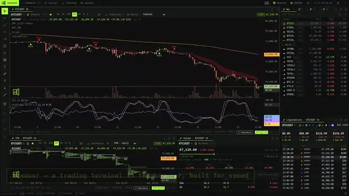
  </picture>
</p>

- **Fast.** The chart engine is Rust in a Web Worker, drawing with WebGL2. The page thread never touches a candle.
- **Order flow.** DOM, tape, footprints, TPO profiles, liquidations and net taker flow.
- **Live.** Fourteen exchanges streamed straight to the browser.
- **Your own indicators.** Frost Script, a small safe language, with a Community to share them.
- **Free and open.** AGPL-3.0, one Docker image to host it yourself.

## Features

### Charts and workspace

<p align="center">
  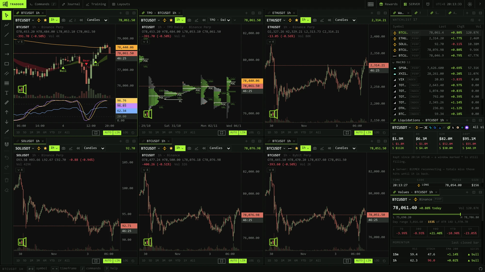
</p>

- Up to 20 charts at once; symbol, interval, crosshair and time kept in step
- Panels split, tab and dock by drag; layouts saved by name
- One minute to a year, linear or log, bar replay on any chart
- Drawings belong to the market and show on every chart and timeframe of it
- Watchlists, price alerts to Telegram, themes, a US economic calendar
- Signed in with Telegram, the same workspace on every device

### Fourteen exchanges

<p align="center">
  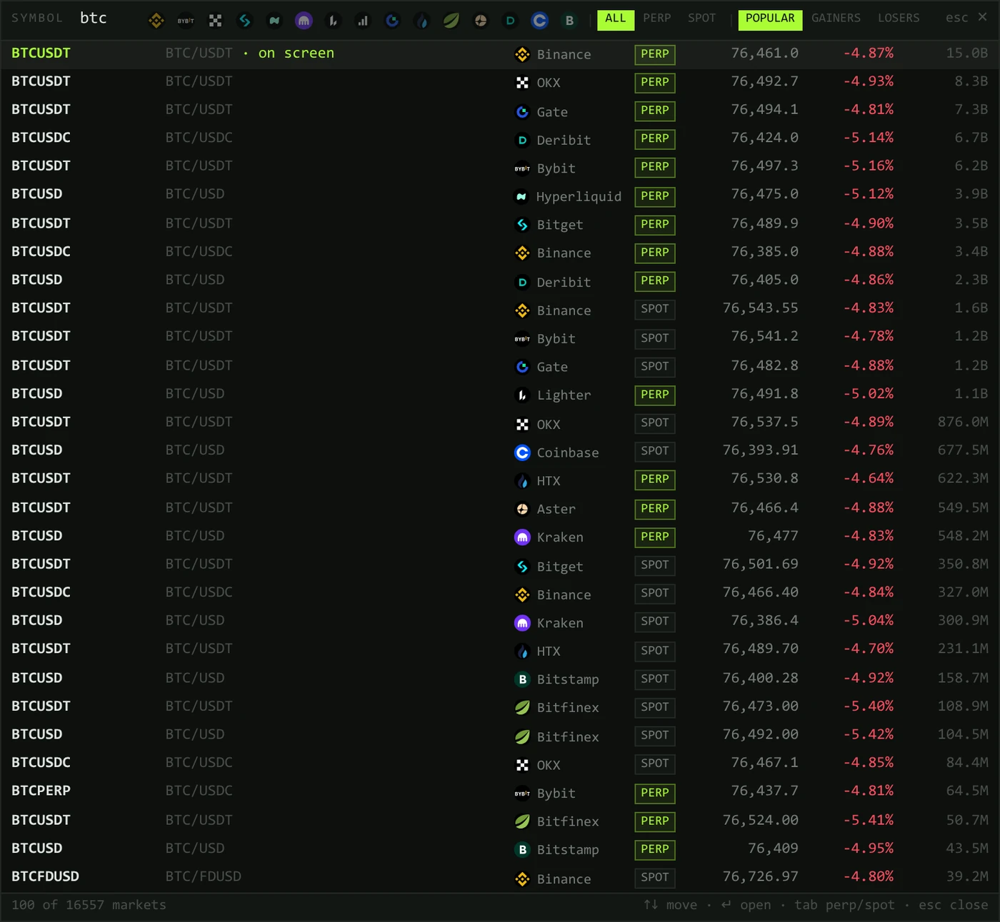
</p>

Binance, Bybit, OKX, Bitget, Kraken, Hyperliquid, Lighter, Gate, Aster, HTX, Bitfinex, Deribit, Coinbase and Bitstamp: some 16,500 markets in one search. Also TOTAL, TOTAL2, TOTAL3, BTC.D and the other market measures, the VIX, and the S&amp;P 500 and Nasdaq-100 as trade.xyz perpetuals.

### Indicators

<p align="center">
  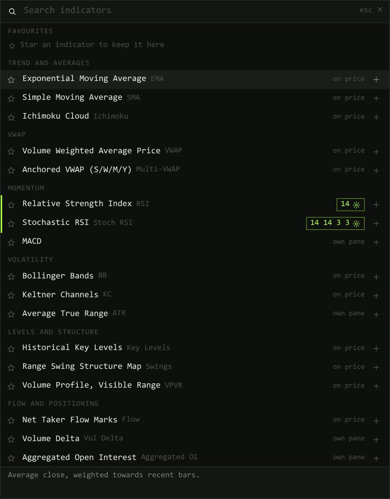
</p>

Built-in, Community and My scripts in one searchable picker. EMA ribbon, EMA 200, RSI, Stoch RSI, MACD, Bollinger Bands, Keltner, Ichimoku, VWAP and VWAP levels, anchored VWAP, volume delta, volume profile, key levels, swing structure map, sessions, moon phases and open interest, each with its own settings.

### DOM and tape

<p align="center">
  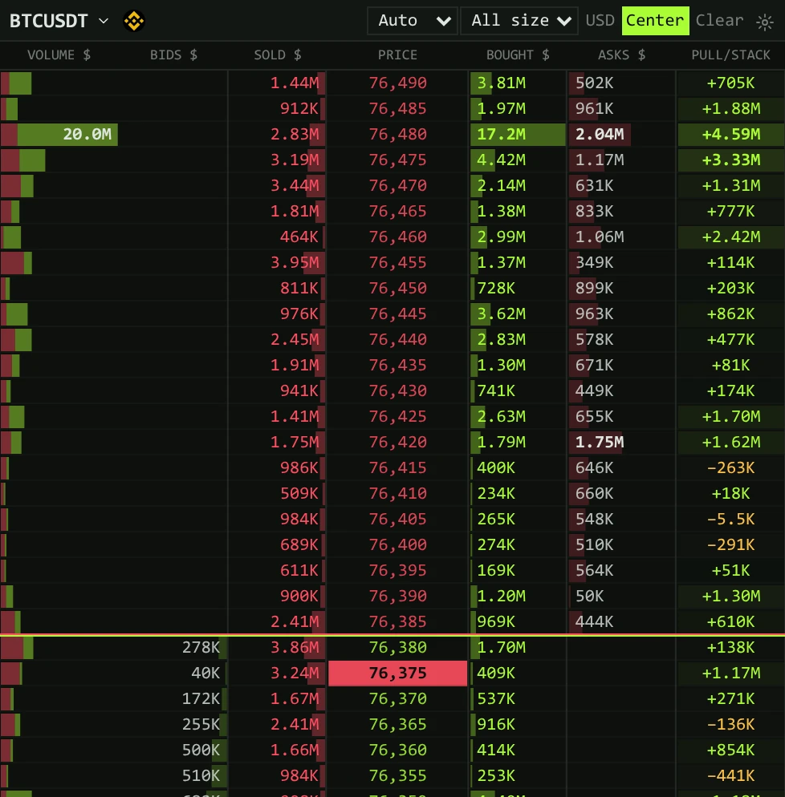
  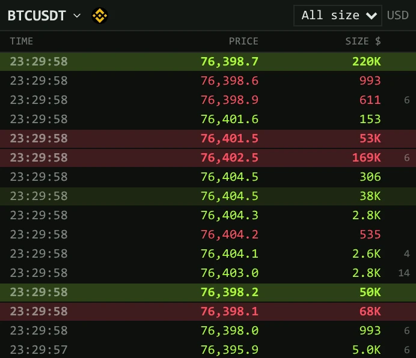
</p>

The order book by price on all fourteen exchanges: bids, asks, what traded at each price, a volume profile and Pull/Stack. The tape prints every trade and lights the big ones.

### Market profile and footprint

<p align="center">
  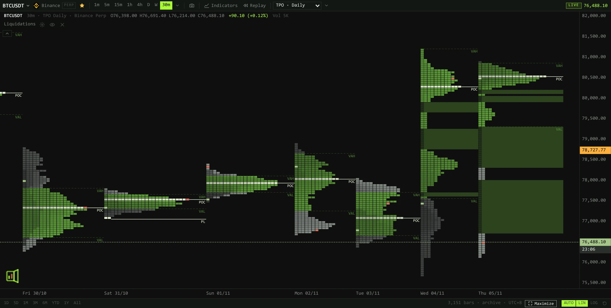
</p>

<p align="center">
  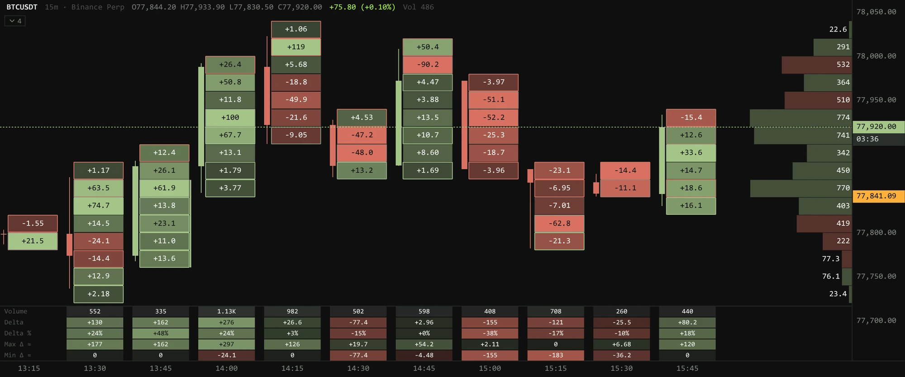
</p>

- TPO profiles by day, week, month or session, with value area, POC, single prints and poor highs and lows
- Footprints as delta, bid and ask, volume, cluster or ladder, with a per-bar table
- Footprint history kept on the server for BTC and ETH; any other coin is recorded in your own browser

### Liquidations, flow and signals

<p align="center">
  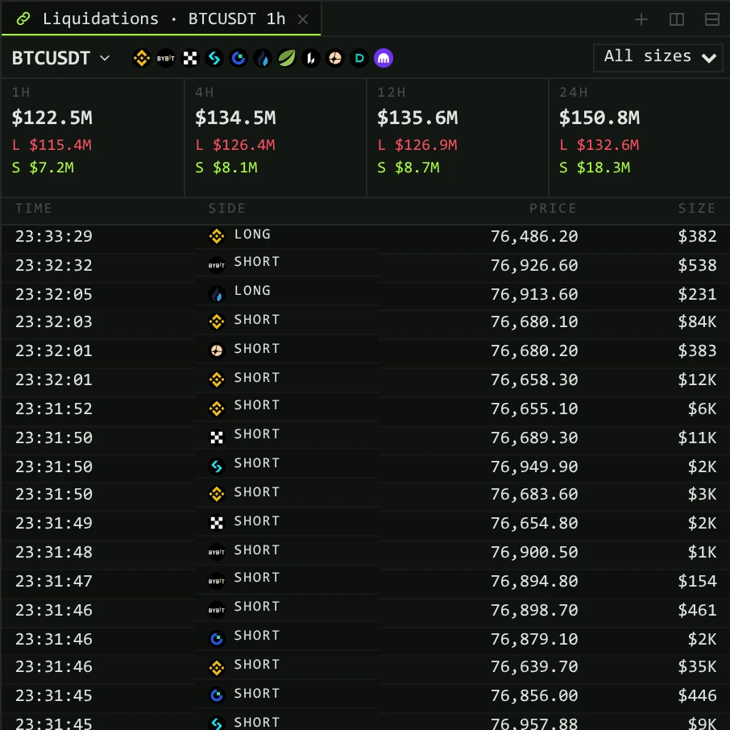
</p>

- Liquidations from eleven exchanges, as a tape, totals and a feed on the chart
- Net taker flow per exchange, spot and perpetual
- A screener for three-drive patterns across 200 coins, with Telegram alerts

### Journal and training

<p align="center">
  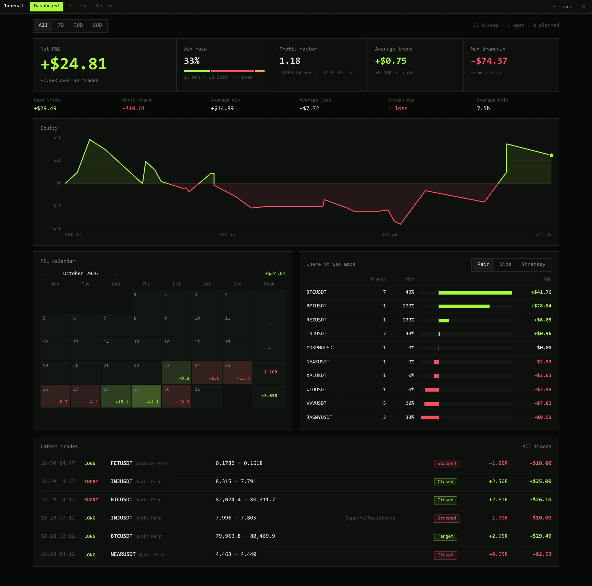
</p>

- Every long or short position you draw is a journal trade, settled by price
- A dashboard: P&amp;L, win rate, equity curve, calendar in money or R, by pair, side or strategy
- Paper trading: 100,000 USDT on Binance's BTC, ETH and SOL perpetuals at live prices, from the chart or the DOM

### On a phone

<p align="center">
  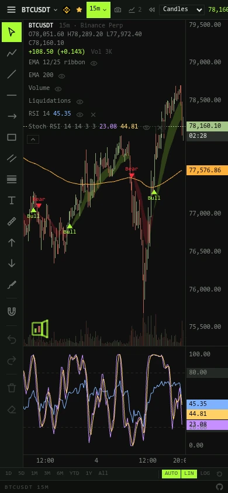
</p>

The same terminal with touch gestures, on any browser with WebGL2, and a 2D canvas where there is none.

## Frost Script

```
input length = 20 min 2 max 500 "Length"
average = ema(close, length)
plot(average, "Average", blue)
mark(crossover(close, average), "Up", below, green)
```

tradoor's own language for indicators.

- **Draws:** lines, histograms, levels, fills, marks, labels, boxes, a table, background shading and candle colours.
- **Language:** texts, lists, your own functions, loops, and colours as `#hex` or `rgb()`.
- **Settings:** numbers, tick boxes, colours, choices and dates, like any built-in.
- **Built-ins as source:** 18 built-ins are written in Frost Script. Open one's settings and the Source tab shows it, giving the same numbers. The six that need more than candles say why.
- **From Pine Script v6:** the editor copies instructions for an AI chat (Claude, ChatGPT, Gemini…) that converts a Pine v6 indicator.
- **Community:** share a script under a username chosen once, with a description. Every public one is drawn live on the [showcase](https://tradoorterminal.com/community.html).
- **Docs:** the [reference](https://tradoorterminal.com/doc.html) has the whole language.

A script can only draw on its chart. It runs in a WebAssembly module that imports nothing, has no way to reach the network, the page or an account, and is held to limits on depth, memory and work. The worst a script can do is draw a wrong line.

## Run it

Needs Rust 1.95 with `wasm32-unknown-unknown`, `wasm-bindgen-cli` 0.2.128, Deno 2 and Docker (`wasm-opt` optional).

```sh
cp .env.example .env          # choose a database password
docker compose up -d          # PostgreSQL 18 on 127.0.0.1:5438
./scripts/build-wasm.sh       # chart engine and Frost Script module
cargo build --release

set -a; . ./.env; set +a
./target/release/tradoor-backfill binance-perp:BTCUSDT --from 2021-09-01 --track
./target/release/tradoor-recorder &
./target/release/tradoor-server

cd web && deno install && deno task dev   # http://127.0.0.1:5173
```

Markets are written `venue:SYMBOL`, for example `binance-perp:BTCUSDT`. One not backfilled still charts, from the exchange's REST API.

Tests: `cargo test`, then in `web/`: `deno task check`, `deno task test`, and `deno task size` after `deno task build`.

Keys: `a–z` symbol · `← →` timeframe · `/` or `Ctrl K` commands · `?` help · `Esc` cancel · `Delete` remove a drawing.

## How it's built

- **Engine:** Rust to WebAssembly (about 142 kB gzip) in a Web Worker, WebGL2 on an OffscreenCanvas.
- **History:** columnar partition files, about 16 bytes a minute: five years of BTCUSDT minutes in 42 MB, cached by the browser for a year.
- **Live:** exchange WebSockets straight to the browser; the server relays only when a browser can't reach an exchange.
- **Frost Script:** `crates/formula`, its own WebAssembly module; the server checks every saved script with the same crate.
- **Server:** Rust (Axum, Tokio) and PostgreSQL 18 for metadata only. Candles never enter the database.
- **UI:** SolidJS, about 59 kB brotli.

```text
crates/core      candles, timeframes, indicators and studies
crates/codec     the partition format (docs/format.md)
crates/venues    the exchanges
crates/store     the data directory and PostgreSQL metadata
crates/ingest    archive and REST sync
crates/render    the chart as a pure model
crates/wasm      the browser engine
crates/formula   Frost Script
bins/server      API, /data and the web app
bins/backfill    download history
bins/recorder    keep tracked markets current
web/             the SolidJS app (Vite, Deno)
migrations/      PostgreSQL schema
deploy/          compose, systemd and nginx
```

More in [docs/architecture.md](docs/architecture.md).

## Self-hosting

<details>
<summary><b>On a server</b></summary>

<br>

One image holds the binaries and the web app; `deploy/compose.yml` runs it beside PostgreSQL, and the host's nginx serves the app and proxies `/api` and `/data`.

```sh
# On your machine
docker build -t tradoor:latest .
ssh user@server 'sudo mkdir -p /var/www/tradoor && sudo chown $USER /var/www/tradoor'
docker save tradoor:latest | gzip | ssh user@server 'gunzip | docker load'
scp deploy/compose.yml deploy/nginx/tradoor.conf deploy/nginx/security-headers.conf deploy/nginx/http.conf user@server:/var/www/tradoor/
scp deploy/env.example user@server:/var/www/tradoor/.env

# On the server
cd /var/www/tradoor
nano .env        # POSTGRES_PASSWORD: openssl rand -hex 24
docker compose up -d
docker compose run --rm server tradoor-backfill binance-perp:BTCUSDT --from 2021-09-01 --track

sudo cp tradoor.conf /etc/nginx/sites-available/tradoor   # set server_name first
sudo cp security-headers.conf /etc/nginx/snippets/tradoor-security-headers.conf
sudo cp http.conf /etc/nginx/conf.d/tradoor.conf
sudo ln -s /etc/nginx/sites-available/tradoor /etc/nginx/sites-enabled/
sudo nginx -t && sudo systemctl reload nginx
sudo certbot --nginx -d tradoor.example.com
```

Migrations run when the server starts. To update, load a new image and run `docker compose up -d`. Without Docker, `deploy/systemd` runs the binaries directly.

</details>

<details>
<summary><b>CI and deploy</b></summary>

<br>

Every push runs the Rust tests, the WASM build, and the web app's type check, build and size budget. A push to `main` then builds the image, pushes it to `ghcr.io/<owner>/tradoor:<commit>`, points the server at it and waits for `/api/health`.

```sh
ssh-keygen -t ed25519 -N '' -C tradoor-github-actions -f ~/.ssh/tradoor_deploy
ssh -p <port> root@<server> 'cat >> ~/.ssh/authorized_keys' < ~/.ssh/tradoor_deploy.pub
gh secret set VPS_HOST --body <server>
gh secret set VPS_PORT --body <port>
gh secret set VPS_USER --body root
gh secret set VPS_SSH_KEY < ~/.ssh/tradoor_deploy
ssh-keyscan -p <port> <server> | gh secret set VPS_KNOWN_HOSTS
```

To roll back, set `TRADOOR_IMAGE` in `.env` to an earlier commit's tag and run `docker compose up -d`.

</details>

<details>
<summary><b>Options</b></summary>

<br>

- **`SITE_URL`** (repository variable): canonical URL, Open Graph image, `robots.txt` and sitemap, and links in Telegram messages.
- **`CF_BEACON`** (repository variable): a Cloudflare Web Analytics token. Page views only, no cookie; without it the page loads no analytics.
- **`TRADOOR_ADMIN_KEY`** (server `.env`, `openssl rand -hex 32`): opens `/online.html`, the status page, with readers, accounts, server load, Frost Script moderation and announcements.
- **Partner exchanges:** Rewards in the top bar lists referral links (`web/src/components/Referrals.tsx`), offered once per browser; `?noreferral` turns the offer off on a device.
- **Flow of other coins:** signed-in readers add up to seven coins of their own; the server records at most twenty at a time.
- **Indices:** TOTAL, BTC.D and the rest are worked out by the server from CoinGecko's figures; the VIX is Cboe's, delayed.

</details>

<details>
<summary><b>Browser ids and moving data</b></summary>

<br>

Each browser makes a random id (Settings → Advanced) that its drawings, layout, watchlists, indicators and alerts are kept under. Sign in with Telegram to carry them to other devices.

```sh
docker compose exec server tradoor-server adopt <your-browser-id>   # claim drawings saved before ids existed
RSALIANTO_DATABASE_URL=postgres://… scripts/export-rsalianto-drawings.sh > drawings.jsonl
./target/release/tradoor-server import-drawings drawings.jsonl --owner <your-browser-id>
ssh user@server 'bash -s' < scripts/export-signals.sh > signals.tar.gz   # the screener's record
./target/release/tradoor-server signal-research signals.jsonl
```

</details>

## Security

- **Sessions:** a Telegram sign-in gives the browser a random token, and the server keeps only its hash. `/signout` to the bot ends every session.
- **Rate limits** per address and per kind of request, and per exchange host for the relay (`bins/server/src/limits.rs`).
- **Relay:** only the exchanges' market data calls, over HTTPS, without following redirects.
- **Database:** every value goes in as a bound parameter.
- **Page:** a strict Content Security Policy with no inline scripts, and user text is always shown as text, never as HTML.
- **Frost Script:** limits on size, depth, memory and steps; the server checks scripts on a thread of their own, four at a time.

The server reads the visitor's address from nginx's `X-Real-IP`, so it must only be reachable through nginx; `deploy/compose.yml` publishes it on loopback. `http.conf` keys nginx's limits on Cloudflare's `CF-Connecting-IP`, which is trustworthy only where nginx admits nothing but Cloudflare (`allow` its ranges, `deny all`). After certbot adds its HTTPS block, merge `tradoor.conf`'s locations into the site by hand.

## License

[GNU Affero General Public License, version 3](LICENSE). If you run a modified version for others over a network, you must offer them its source.

Copyright © 2026 rsalianto.
